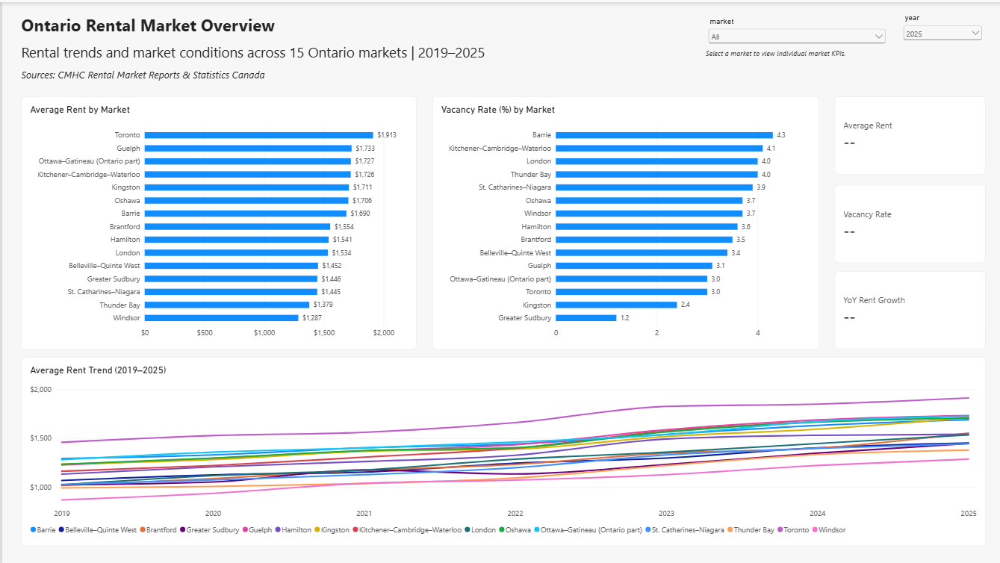
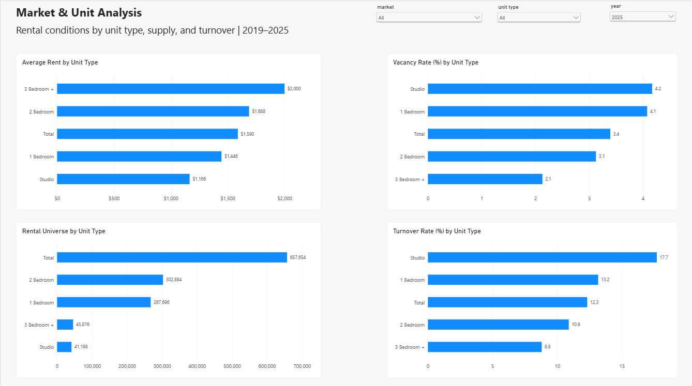
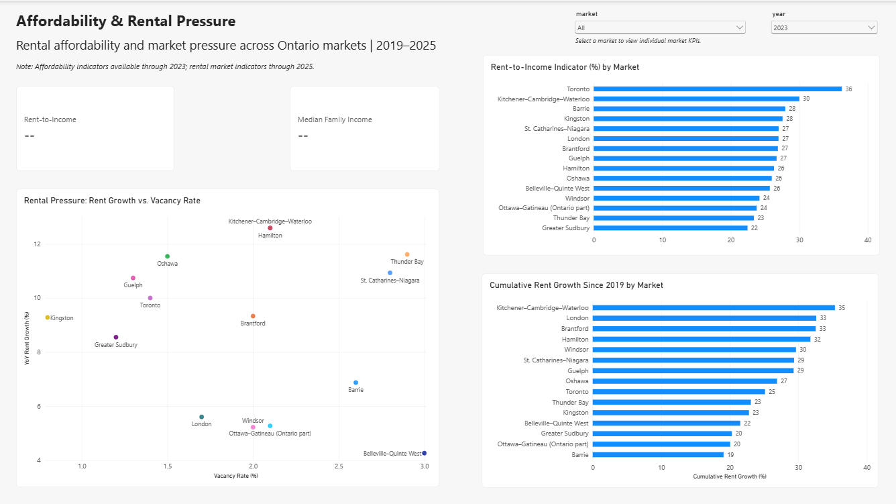

# Ontario Rental Market Intelligence
### Affordability, Vacancy & Rental Pressure Analysis (2019–2025)

**Tools:** Excel · Python · PostgreSQL · SQL · Power BI  
**Geographic Coverage:** 15 Ontario rental markets  
**Analysis Period:** 2019–2025 (rental market data) | 2019–2023 (income data)

## Project Overview

Finding affordable rental housing in Ontario can be challenging, particularly when rental prices, housing availability, and local income levels vary considerably between cities.

Inspired by my own experience navigating Ontario's rental market, I developed this end-to-end analytics project to better understand how rental conditions have changed over time and how affordability differs across markets.

The project integrates rental market statistics from the Canada Mortgage and Housing Corporation (CMHC) with family income data from Statistics Canada. Using Excel for data auditing, Python for source extraction, PostgreSQL for data transformation and analytical calculations, and Power BI for interactive reporting, I created a three-page dashboard to support evidence-based rental market comparisons.

The analysis is framed around the information needs of an **Ontario Housing Strategy & Market Intelligence Team**, with an emphasis on identifying markets experiencing higher rents, lower vacancy, stronger rental growth, and greater rent-to-income pressure.

## Business Questions

1. How have average rents and vacancy rates changed across Ontario rental markets between 2019 and 2025?
2. Which markets have experienced the strongest rental price growth?
3. How do rental supply, turnover rates, and rental conditions differ across markets and unit types?
4. Which markets exhibit signs of rental pressure when comparing rent growth and vacancy rates?
5. How does average market rent compare with median after-tax family income across Ontario markets?

## Data Sources

| Source | Dataset | Coverage |
|---|---|---|
| Canada Mortgage and Housing Corporation (CMHC) | Rental Market Reports — Ontario | 2019–2025 |
| Statistics Canada | Table 11-10-0017-01 — Census families by family type and family composition, including median after-tax family income | 2019–2023 |

The CMHC dataset includes average rent, vacancy rate, rental universe, published percentage change in average rent, and turnover rate for private apartment rental markets.

The Statistics Canada dataset provides median after-tax family income for comparable geographic markets.

The analysis covers 15 Ontario markets, including Toronto, Ottawa–Gatineau (Ontario part), Hamilton, London, Windsor, Kingston, Guelph, and Kitchener–Cambridge–Waterloo.

## Tools & Analytical Workflow

### 1. Excel — Data Audit & Source Preparation

Created a structured audit workbook to document the source files, define important data fields, standardize geographic mappings, and validate source completeness.

The workbook includes:

- Source inventory and validation
- Data dictionary
- Geographic crosswalk
- Quality assurance checks

**Deliverable:** [Excel Data Audit Workbook](excel/rental_market_data_audit.xlsx)

### 2. Python — Source Data Extraction

Developed Python scripts to extract relevant observations from the original CMHC Excel workbooks and Statistics Canada source data.

The scripts:

- Extracted annual rental market measures across 15 markets and five unit categories
- Standardized the extracted file structure for SQL ingestion
- Selected the required family income observations using exact geographic and statistical classifications
- Produced reproducible CSV inputs for the PostgreSQL workflow

Python was used for source extraction rather than duplicating the analytical calculations performed in SQL.

**Scripts:** [CMHC Extraction](scripts/extract_cmhc.py) | [Statistics Canada Extraction](scripts/extract_statscan.py)

### 3. PostgreSQL — Data Transformation & Analytics

Built a relational SQL workflow using separate `raw`, `clean`, and `analytics` schemas.

Key transformations included:

- Standardizing geographic identifiers across both data sources
- Converting source values into appropriate numeric fields
- Preserving CMHC reliability codes and unavailable observations
- Standardizing Bachelor/Studio unit terminology
- Restructuring rental measures into a market-year-unit analytical dataset
- Integrating rental market and family income data
- Calculating year-over-year and cumulative rent growth, rental supply growth, and a rent-to-income indicator
- Creating reusable analytical views for Power BI

**SQL Files:** [Database Schema](sql/schema/) | [Analytical Views](sql/views/)

### 4. Power BI — Interactive Market Intelligence Dashboard

Developed a three-page Power BI report with market, year, and unit-type filtering.

The dashboard enables users to explore rental trends, compare markets, examine differences between unit types, and assess rental pressure alongside income-based indicators.

**Power BI File:** [Ontario Rental Market Intelligence](powerbi/Ontario_Rental_Market_Intelligence.pbix)

## Dashboard Preview

### Page 1 — Ontario Market Overview



Provides an overview of average rents, vacancy rates, annual rent growth, and historical rent trends across the 15 markets.

### Page 2 — Market & Unit Analysis



Compares average rent, vacancy, rental universe, and turnover rates across different apartment unit categories.

### Page 3 — Affordability & Rental Pressure



Explores market-level rent-to-income indicators, cumulative rent growth, and the relationship between annual rent growth and vacancy rates.

Income-based indicators are available through 2023, while rental market indicators extend through 2025.

## Selected Analytical Findings

The following findings illustrate how the dashboard can support comparisons across markets.

**1. Rental prices vary substantially across Ontario markets.**

Toronto recorded an average rent of approximately **$1,913 in 2025**, the highest among the 15 markets included in this analysis.

**2. The markets with the strongest rent growth are not necessarily those with the highest current rents.**

Between 2019 and 2025, Brantford experienced approximately **53% cumulative average rent growth**, while London experienced approximately **50%**. Toronto's cumulative growth over the same period was approximately **31%**.

**3. Vacancy conditions differ meaningfully across markets.**

In 2025, Greater Sudbury recorded a vacancy rate of approximately **1.2%**, compared with approximately **4.3%** in Barrie. These differences highlight the importance of evaluating local rental availability rather than relying on province-wide assumptions.

**4. Rental costs represent different proportions of local family income.**

For 2023, Toronto's market-level rent-to-income indicator was approximately **36.2%**, based on annualized average monthly rent relative to median after-tax family income.

This indicator supports geographic comparisons but should not be interpreted as the actual housing-cost burden of individual renter households.

**5. Rental pressure requires multiple indicators.**

Markets with stronger annual rent growth and lower vacancy may exhibit greater rental pressure. The dashboard presents these indicators together for descriptive comparison; it does not establish a causal relationship between vacancy and rent growth.

## Key Metrics

| Metric | Description |
|---|---|
| Average Rent | CMHC-reported average monthly rent |
| Vacancy Rate (%) | Percentage of rental units reported as vacant |
| Calculated YoY Rent Growth (%) | Percentage change in average rent relative to the previous year |
| Cumulative Rent Growth (%) | Percentage change in average rent relative to 2019 |
| Rental Universe | Number of units in the surveyed rental stock |
| Rental Supply Growth (%) | Year-over-year percentage change in rental universe |
| Turnover Rate (%) | CMHC-reported rental turnover rate |
| Rent-to-Income Indicator (%) | Annualized average monthly rent divided by median after-tax family income |

## Methodology & Limitations

**Rental market coverage:** CMHC measures cover the private apartment rental market represented in its published reports. Results should not be generalized to every rental property or housing type in Ontario.

**Unit categories:** The published `Total` category represents all apartment unit types. It is not added to the individual bedroom categories when calculating combined totals.

**Missing observations:** CMHC source values containing nonnumeric symbols, such as `**` and `++`, were retained as unavailable rather than replaced with estimated values. Reliability information was preserved during data preparation.

**Rent growth definitions:** Calculated year-over-year rent growth is derived from annual average rent observations. It may differ from CMHC's published percentage change in average rent because the published measure uses its own methodology. These measures are kept distinct.

**Affordability interpretation:** The rent-to-income indicator is an aggregate market-level comparison:

`(Average Monthly Rent × 12 ÷ Median After-Tax Family Income) × 100`

The rent and income statistics do not necessarily represent the same households. Therefore, this measure is **not an official household housing affordability rate**.

**Income availability:** Statistics Canada family income observations in this project cover 2019–2023. Income values were not estimated or extended to 2024–2025.

**Rental pressure interpretation:** Rent growth and vacancy are presented together to identify market patterns. The analysis is descriptive and does not establish causation.

## Repository Structure

```text
Ontario_Rental_Market_Intelligence/
├── data/
│   ├── processed/
│   └── raw/
├── excel/
│   └── rental_market_data_audit.xlsx
├── powerbi/
│   ├── Ontario_Rental_Market_Intelligence.pbix
│   └── screenshots/
│       ├── 01_market_overview.png
│       ├── 02_market_unit_analysis.png
│       └── 03_affordability_rental_pressure.png
├── scripts/
│   ├── extract_cmhc.py
│   └── extract_statscan.py
├── sql/
│   ├── schema/
│   └── views/
└── README.md
```

## Exploring the Project

- Review the dashboard screenshots above for a quick overview of the analysis.
- Open the `.pbix` file in Power BI Desktop to explore the report. Refreshing its data requires access to a compatible PostgreSQL database.
- Review the Excel audit workbook for source documentation, geographic mappings, and validation checks.
- Explore the SQL scripts to understand the database structure, cleaning workflow, and analytical calculations.
- Review the Python extraction scripts for the source preparation process.

The processed CSV files provide the extracted data used in the PostgreSQL workflow. Original source files may need to be obtained separately from CMHC and Statistics Canada to reproduce extraction from the beginning.

## Project Skills Demonstrated

**Data Analytics:** Exploratory market comparisons, KPI design, trend analysis, and affordability indicators

**SQL & PostgreSQL:** Data modeling, transformations, joins, analytical views, and time-based calculations

**Power BI:** Interactive dashboards, DAX measures, data visualization, and report validation

**Excel:** Data auditing, source documentation, data dictionaries, and quality assurance

**Python:** Reproducible extraction of structured source data

**Analytical Communication:** Translating public datasets into business-oriented findings while documenting methodological limitations

---

*Portfolio project developed for analytical learning and demonstration purposes. Data originates from CMHC and Statistics Canada; findings and interpretations are my own.*